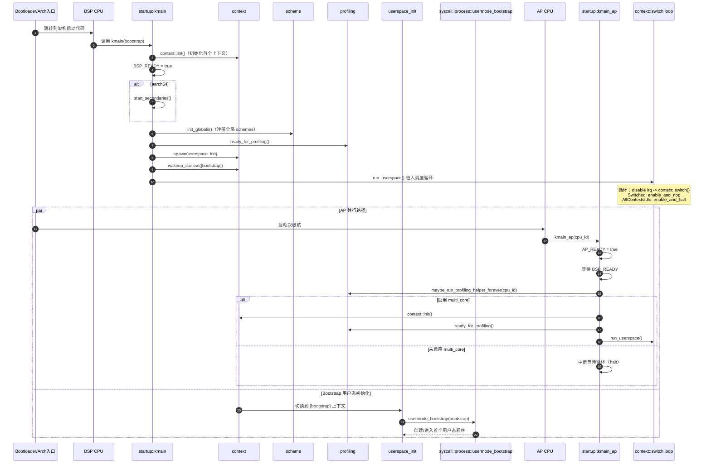
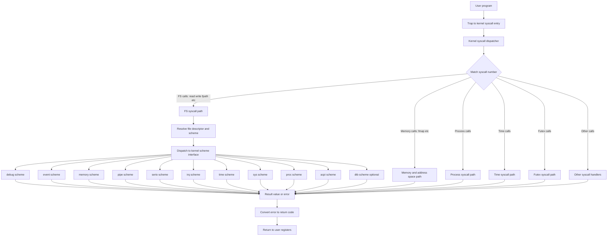

# Redox 代码模块解析

- **URL**: https://github.com/orgs/KMiri-rs/discussions/301
- **Category**: General
- **Author**: zjp-CN
- **Created**: 2026-10-29T01:09:59Z
- **Updated**: 2026-10-31T11:26:06Z
- **Comments**: 6

## Body

# Kernel 仓库

`Redox` 内核项目大致是一个 **“主内核 + 两个基础库”** 的结构：

**1) 顶层组成**
- `kernel`（根 crate）：真正的微内核实现（调度、内存、系统调用、设备、架构启动等）。
- `rmm/`：Redox Memory Management 库，提供跨架构页表/地址/帧分配抽象。
- `syscall/`：系统调用 ABI 与数据结构库（调用号、错误码、flag、寄存器结构、userspace 调用封装）。

**2) 内核主模块（`src/`）**
- 启动与引导：`startup`（BSP/AP 入口、启动参数、进入 userspace bootstrap）。
- 架构适配：`arch`（按 `x86/x86_64/aarch64/riscv64` 分层，含中断、分页、IPI、时钟、启动/停机）。
- 内存体系：`memory` + `allocator`（物理帧分配、页映射、内核堆、NUMA 感知分配）。
- 硬件描述解析：`acpi`、`dtb`（CPU/中断控制器/定时器等拓扑与表解析）。
- 进程/线程上下文：`context`（上下文对象、地址空间、信号、超时、调度切换）。
- 系统调用处理：`syscall`（统一 syscall 分发，按 fs/process/time/futex/usercopy 等子模块实现）。
- Scheme 子系统：`scheme`（Redox 的“类 VFS/命名空间接口”核心，内核内置 `debug/event/memory/pipe/serio/irq/time/sys/proc/acpi`，可选 `dtb`）。
- 设备与调试：`devices`（串口等）+ `log` + `debugger` + `profiling` + `ptrace`。
- 并发与运行时支撑：`sync`、`percpu`、`cpu_stats`、`event`、`time`、`panic`、`numa`。

**3) 架构层细分特点**
- `x86` 与 `x86_64` 共享 `x86_shared`（GDT/IDT/APIC/IOAPIC/PIT/HPET/TSC/PTI 等）。
- `aarch64` 侧重 GIC/PSCI/通用定时器/DTB 设备初始化。
- `riscv64` 侧重 PLIC/CLINT/HLIC 与 SBI/DTB 初始化路径。
- 每个架构都提供 `arch_copy_to_user/from_user`、中断入口和分页实现。

**4) 配套构建资源**
- `targets/`：各架构目标 JSON。
- `linkers/`：各架构链接脚本。
- `build.rs`、`Makefile`：构建流程与汇编/链接配置。

一句话总结：这是一个以 `scheme + syscall + context/scheduler` 为核心、由 `arch` 与 `memory/rmm` 承载硬件差异的 Redox 微内核实现。  


我可以下一步给你画一版“启动时序图（从 `kmain` 到第一个用户态进程）”和“syscall 到 scheme 的调用链图”。

好的，下面给你两张基于当前代码结构整理的图，使用 GitHub 可渲染的 Mermaid。


<details><summary>启动时序图（`kmain` / `kmain_ap`）</summary>
<p>



</p>
</details> 

<details><summary>系统调用到 Scheme 调用链图</summary>
<p>




</p>
</details> 


## Raw data

```json
{
  "number": 301,
  "title": "Redox 代码模块解析",
  "url": "https://github.com/orgs/KMiri-rs/discussions/301",
  "isAnswered": null,
  "body": "# Kernel 仓库\r\n\r\n`Redox` 内核项目大致是一个 **“主内核 + 两个基础库”** 的结构：\r\n\r\n**1) 顶层组成**\r\n- `kernel`（根 crate）：真正的微内核实现（调度、内存、系统调用、设备、架构启动等）。\r\n- `rmm/`：Redox Memory Management 库，提供跨架构页表/地址/帧分配抽象。\r\n- `syscall/`：系统调用 ABI 与数据结构库（调用号、错误码、flag、寄存器结构、userspace 调用封装）。\r\n\r\n**2) 内核主模块（`src/`）**\r\n- 启动与引导：`startup`（BSP/AP 入口、启动参数、进入 userspace bootstrap）。\r\n- 架构适配：`arch`（按 `x86/x86_64/aarch64/riscv64` 分层，含中断、分页、IPI、时钟、启动/停机）。\r\n- 内存体系：`memory` + `allocator`（物理帧分配、页映射、内核堆、NUMA 感知分配）。\r\n- 硬件描述解析：`acpi`、`dtb`（CPU/中断控制器/定时器等拓扑与表解析）。\r\n- 进程/线程上下文：`context`（上下文对象、地址空间、信号、超时、调度切换）。\r\n- 系统调用处理：`syscall`（统一 syscall 分发，按 fs/process/time/futex/usercopy 等子模块实现）。\r\n- Scheme 子系统：`scheme`（Redox 的“类 VFS/命名空间接口”核心，内核内置 `debug/event/memory/pipe/serio/irq/time/sys/proc/acpi`，可选 `dtb`）。\r\n- 设备与调试：`devices`（串口等）+ `log` + `debugger` + `profiling` + `ptrace`。\r\n- 并发与运行时支撑：`sync`、`percpu`、`cpu_stats`、`event`、`time`、`panic`、`numa`。\r\n\r\n**3) 架构层细分特点**\r\n- `x86` 与 `x86_64` 共享 `x86_shared`（GDT/IDT/APIC/IOAPIC/PIT/HPET/TSC/PTI 等）。\r\n- `aarch64` 侧重 GIC/PSCI/通用定时器/DTB 设备初始化。\r\n- `riscv64` 侧重 PLIC/CLINT/HLIC 与 SBI/DTB 初始化路径。\r\n- 每个架构都提供 `arch_copy_to_user/from_user`、中断入口和分页实现。\r\n\r\n**4) 配套构建资源**\r\n- `targets/`：各架构目标 JSON。\r\n- `linkers/`：各架构链接脚本。\r\n- `build.rs`、`Makefile`：构建流程与汇编/链接配置。\r\n\r\n一句话总结：这是一个以 `scheme + syscall + context/scheduler` 为核心、由 `arch` 与 `memory/rmm` 承载硬件差异的 Redox 微内核实现。  \r\n\r\n\r\n我可以下一步给你画一版“启动时序图（从 `kmain` 到第一个用户态进程）”和“syscall 到 scheme 的调用链图”。\r\n\r\n好的，下面给你两张基于当前代码结构整理的图，使用 GitHub 可渲染的 Mermaid。\r\n\r\n\r\n<details><summary>启动时序图（`kmain` / `kmain_ap`）</summary>\r\n<p>\r\n\r\n```mermaid\r\nsequenceDiagram\r\n    autonumber\r\n    participant Boot as Bootloader/Arch入口\r\n    participant BSP as BSP CPU\r\n    participant Startup as startup::kmain\r\n    participant Ctx as context\r\n    participant Scheme as scheme\r\n    participant Prof as profiling\r\n    participant UInit as userspace_init\r\n    participant Proc as syscall::process::usermode_bootstrap\r\n    participant AP as AP CPU\r\n    participant APS as startup::kmain_ap\r\n    participant Sched as context::switch loop\r\n\r\n    Boot->>BSP: 跳转到架构启动代码\r\n    BSP->>Startup: 调用 kmain(bootstrap)\r\n    Startup->>Ctx: context::init()（初始化首个上下文）\r\n    Startup->>Startup: BSP_READY = true\r\n\r\n    alt aarch64\r\n        Startup->>Startup: start_secondaries()\r\n    end\r\n\r\n    Startup->>Scheme: init_globals()（注册全局 schemes）\r\n    Startup->>Prof: ready_for_profiling()\r\n    Startup->>Ctx: spawn(userspace_init)\r\n    Startup->>Ctx: wakeup_context([bootstrap])\r\n    Startup->>Sched: run_userspace() 进入调度循环\r\n\r\n    Note over Sched: 循环：disable irq -> context::switch()<br/>Switched: enable_and_nop<br/>AllContextsIdle: enable_and_halt\r\n\r\n    par AP 并行路径\r\n        Boot->>AP: 启动次级核\r\n        AP->>APS: kmain_ap(cpu_id)\r\n        APS->>APS: AP_READY = true\r\n        APS->>APS: 等待 BSP_READY\r\n        APS->>Prof: maybe_run_profiling_helper_forever(cpu_id)\r\n        alt 启用 multi_core\r\n            APS->>Ctx: context::init()\r\n            APS->>Prof: ready_for_profiling()\r\n            APS->>Sched: run_userspace()\r\n        else 未启用 multi_core\r\n            APS->>APS: 中断等待循环（halt）\r\n        end\r\n    and Bootstrap 用户态初始化\r\n        Ctx->>UInit: 切换到 [bootstrap] 上下文\r\n        UInit->>Proc: usermode_bootstrap(bootstrap)\r\n        Proc-->>UInit: 创建/进入首个用户态程序\r\n    end\r\n```\r\n\r\n</p>\r\n</details> \r\n\r\n<details><summary>系统调用到 Scheme 调用链图</summary>\r\n<p>\r\n\r\n\r\n```mermaid\r\nflowchart TD\r\n    A[\"User program\"] --> B[\"Trap to kernel syscall entry\"]\r\n    B --> C[\"Kernel syscall dispatcher\"]\r\n    C --> D{\"Match syscall number\"}\r\n\r\n    D -->|\"FS calls: read write fpath etc\"| E[\"FS syscall path\"]\r\n    D -->|\"Memory calls: fmap etc\"| F[\"Memory and address space path\"]\r\n    D -->|\"Process calls\"| G[\"Process syscall path\"]\r\n    D -->|\"Time calls\"| H[\"Time syscall path\"]\r\n    D -->|\"Futex calls\"| I[\"Futex syscall path\"]\r\n    D -->|\"Other calls\"| J[\"Other syscall handlers\"]\r\n\r\n    E --> K[\"Resolve file descriptor and scheme\"]\r\n    K --> L[\"Dispatch to kernel scheme interface\"]\r\n\r\n    L --> N1[\"debug scheme\"]\r\n    L --> N2[\"event scheme\"]\r\n    L --> N3[\"memory scheme\"]\r\n    L --> N4[\"pipe scheme\"]\r\n    L --> N5[\"serio scheme\"]\r\n    L --> N6[\"irq scheme\"]\r\n    L --> N7[\"time scheme\"]\r\n    L --> N8[\"sys scheme\"]\r\n    L --> N9[\"proc scheme\"]\r\n    L --> N10[\"acpi scheme\"]\r\n    L --> N11[\"dtb scheme optional\"]\r\n\r\n    N1 --> O[\"Result value or error\"]\r\n    N2 --> O\r\n    N3 --> O\r\n    N4 --> O\r\n    N5 --> O\r\n    N6 --> O\r\n    N7 --> O\r\n    N8 --> O\r\n    N9 --> O\r\n    N10 --> O\r\n    N11 --> O\r\n\r\n    F --> O\r\n    G --> O\r\n    H --> O\r\n    I --> O\r\n    J --> O\r\n\r\n    O --> P[\"Convert error to return code\"]\r\n    P --> Q[\"Return to user registers\"]\r\n```\r\n\r\n</p>\r\n</details> \r\n",
  "createdAt": "2026-10-29T01:09:59Z",
  "updatedAt": "2026-10-31T11:26:06Z",
  "closedAt": null,
  "author": {
    "login": "zjp-CN"
  },
  "category": {
    "name": "General",
    "slug": "general"
  },
  "comments": {
    "totalCount": 6
  },
  "labels": {
    "nodes": []
  },
  "repository": {
    "nameWithOwner": "KMiri-rs/KMiri"
  }
}
```
